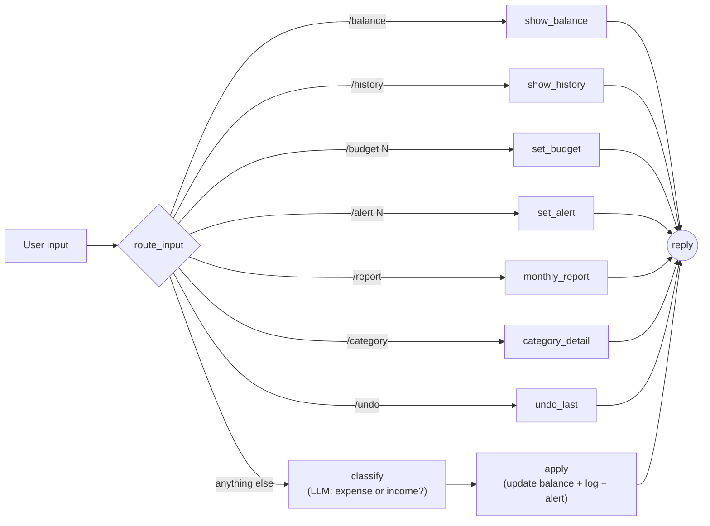

# Budget Assistant

A conversational budget tracker built with [LangGraph](https://github.com/langchain-ai/langgraph) and a local LLM ([Ollama](https://ollama.com)). Just type what you spent or received in plain English — the assistant classifies it, updates your balance, and logs it. No cloud API calls, no account, your data stays on your machine.

Available both as a terminal app and as a Telegram bot.

## Features

- **Natural language input** — "lunch 120", "received salary 30000", "酒吧消費 5 元" all just work
- `/balance` — check current balance
- `/history` — view recent transactions
- `/report [YYYY-MM]` — spending breakdown by category for a given month (defaults to current month)
- `/category name [YYYY-MM]` — list individual transactions in one category
- `/undo [n]` — undo the last `n` transactions
- `/budget amount` — set/reset the current balance
- `/alert amount` — set the low-balance alert threshold
- Automatic monthly report printed on startup when a month has ended
- Transaction history auto-clears every 2 months (balance is kept)

## How it works

Each message is routed through a small [LangGraph](https://github.com/langchain-ai/langgraph) state graph. Slash commands go straight to their handler; anything else is classified by the LLM as an expense or income, with amount/category extracted automatically.



State (balance, alert threshold, transaction history) is persisted to `budget_state.json` so it survives restarts.

## Setup

1. Install [Ollama](https://ollama.com) and pull the model used for classification:
   ```bash
   ollama pull qwen2.5:7b
   ```
2. Install Python dependencies:
   ```bash
   pip install langgraph langchain-core langchain-ollama python-dotenv pydantic
   ```

## Usage

### Terminal

```bash
python budget.py
```

Type what you spent or received, or use one of the `/` commands above. `/quit` to exit.

### Telegram bot (optional)

Lets you chat with the same assistant through Telegram instead of the terminal.

1. Install the extra dependency:
   ```bash
   pip install python-telegram-bot
   ```
2. Create a bot with [@BotFather](https://t.me/BotFather) and copy its token.
3. Copy `.env.example` to `.env` and fill in `TELEGRAM_BOT_TOKEN`.
4. Run `python telegram_bot.py`, then send `/start` to your bot — it replies with your chat ID.
5. Add that chat ID to `.env` as `TELEGRAM_CHAT_ID` and restart. From then on, the bot only responds to that chat.

## Project structure

```
budget.py           # Core logic: LangGraph app, state persistence, all commands
telegram_bot.py      # Telegram front-end, reuses budget.py's logic
budget_state.json   # Generated at runtime — your balance & transaction history (not committed)
.env                 # Your Telegram bot token & chat ID (not committed)
```

## Notes

- All classification runs locally through Ollama — no transaction data ever leaves your machine.
